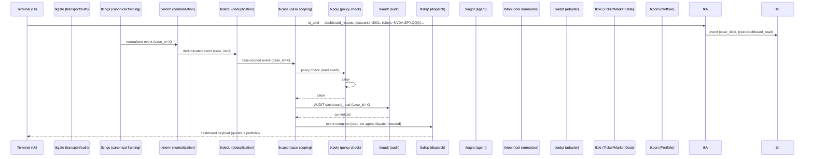

# UC-01: Terminal Data Dashboard

## Description

The user opens the terminal UI. The terminal requests:

1. **Portfolio data** — current holdings, cash balance, sector exposure (pre-aggregated), and account limits.
2. **Ticker data** — real-time prices, quotes, and market indicators for widgets: SPY, QQQ, KWEB, US Treasury rate, crude oil, gold, Bitcoin price, and other market benchmarks.

The request enters through the API tile (`tkgate`), which sets the initial `case_id` and routes the event to the ingestion pipeline (`tkings`). The event flows through normalization (`tknorm`), deduplication (`tkdedu`), and case scoping (`tkcase`). Policy checks it as a read event (`tkpoly` — allowed), and the result is recorded in the audit trail (`tkaudt`). The dashboard agent run is scheduled via `tkdisp`, which calls the agent (`tkagnt`) to fetch data through the tool normalizer (`tktool`) and adapter layer (`tkadpt`) to the market data (`tktkr`) and portfolio (`tkport`) tiles.

## Flow

## Tile Inventory

|| Tile | Runtime ID | Responsibility | Status |
||------|-----------|----------------|--------|
|| `tkgate` | `tkgate` | HTTP/WebSocket CaseOps API tile — receives dashboard request, sets case_id, routes to tkings for canonical event framing | **MISSING** |
|| `tkings` | `tkings` | Universal event ingestion — receives dashboard_read event, frames it canonically, pushes to tknorm | **NOT STARTED** |
|| `tknorm` | `tknorm` | Canonical normalization — normalizes dashboard_read event into canonical facts | **NOT STARTED** |
|| `tkdedu` | `tkdedu` | Deduplication — deduplicates dashboard_read event | **NOT STARTED** |
|| `tkcase` | `tkcase0` | Case scoping — creates case scope for dashboard_read, propagates case_id | **PARTIALLY** — `tk_pass_stem.c` placeholder |
|| `tkpoly` | `tkpoly` | Policy check — `dashboard_read` capability scope (allow read events) | **PARTIALLY** — needs dashboard_read capability |
|| `tkaudt` | `tkaudt` | Audit — records dashboard_read boundary event with case_id | **PARTIALLY** — needs dashboard_read record type |
|| `tkdisp` | `tkdisp` | Dispatch — handles read events (fast acknowledgment) | **EXISTING** — in investment workflow topology |
|| `tkmetr` | `metric` | Metrics tile — tracks dashboard_read latency/count | **EXISTING** |
|| `tkdiag` | `tkdiag` | Diagnostics — observes tile health | **EXISTING** |
|| `tktkr` | `tktkr0` | Market data tile — fetches ticker quotes, prices, market benchmarks (stubbed) | **MISSING** |
|| `tkport` | `tkport0` | Portfolio tile — reads holdings, cash, buying power, sector exposure (stubbed) | **MISSING** |

### What exists today (supporting)

- **`portfolio` schema** (`src/tickoni/schema/portfolio/portfolio.zig`) — `BrokerageAccount`, `Holding`, `AffordabilityResult`, `findHolding()`, five fixture accounts, affordability checks.
- **`mock_broker_market_server`** (`src/tickoni/test/mocks/mock_broker_market_server.zig`) — HTTP server stub with `/health`, `/accounts/2001/portfolio`, `/quotes`, `/paper-orders` endpoints.
- **`mock_adapter`** (`src/tickoni/test/mocks/mock_adapter.zig`) — mock adapter backend with `portfolio_snapshot`, `quote_snapshot`, `paper_order` canned responses.

### What's needed

1. Register `tk_gate` in the tile registry as a semantic API tile.
2. Register `tktkr` tile ID, implement market data fetch stub (returning canned quotes from the mock server or fixture data).
3. Register `tkport` tile ID, implement portfolio read stub (returning canned account snapshots).
4. Wire `tkings` topology with links: `tk_gate` → `tkings` → `tknorm` → `tkdedu` → `tkcase` → `tkpoly` → `tkaudt`.
5. Implement `tk_gate` command handler for `dashboard_request` via shared-memory channel.
6. Add audit record type `dashboard_read` to `tkaudt`.

### System test approach

- Launch the topology with `tk_gate`, `tkings`, `tknorm`, `tkdedu`, `tkcase`, `tkpoly`, `tkport`, `tkaudt`, `tktool`, `tkadpt`, `metric`, `tkdiag`.
- Use `mock_broker_market_server` to serve portfolio and quote data (test infrastructure).
- Send dashboard_request through `ui_cmd` channel (case_id=X, type=dashboard_read, tickers=NVDA,SPY,QQQ).
- Verify: `tkings` canonicalized the event; `tktkr` returned matching quotes; `tkport` returned the correct portfolio for the requested account; `tkaudt` recorded the `dashboard_read` audit event; terminal received the response via `ui_rsp`.
- Replay test: replace live mock with captured capsule, verify identical output.
