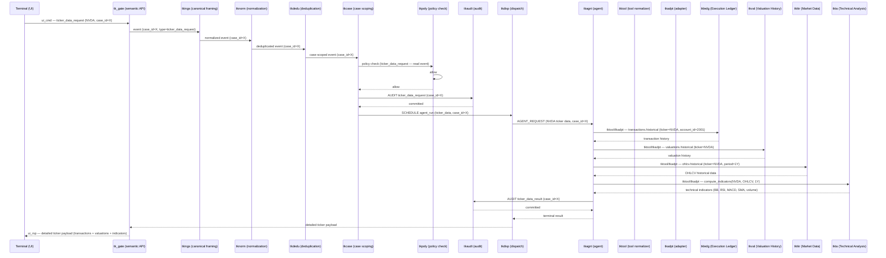

# UC-06: Detailed Ticker Data Request

## Description

The user requests detailed historical data for a ticker (e.g. NVDA). The event enters through `tkgate` (transport/auth), which sets the `case_id` and routes to the ingestion pipeline (`tkings`). The event flows through `tknorm` → `tkdedu` → `tkcase` (case scope created) → `tkpoly` (allowed — read event) → `tkaudt`. The ticker data agent run is scheduled via `tkdisp`, which calls the agent (`tkagnt`) to fetch data through the tool normalizer (`tktool`) and adapter layer (`tkadpt`) to the execution ledger (`tkledg`), valuation store (`tkval`), market data tile (`tktkr`), and technical analysis engine (`tkta`).

## Flow

## Tile Inventory

|| Tile | Runtime ID | Responsibility | Status |
||------|-----------|----------------|--------|
|| `tk_gate` | `tk_gate` | Semantic API tile — receives ticker data request via shared-memory channel, sets case_id, routes to tkings | **MISSING** |
|| `tkings` | `tkings` | Universal event ingestion — receives ticker_data_request event, frames it canonically | **NOT STARTED** |
|| `tknorm` | `tknorm` | Canonical normalization — normalizes ticker_data_request event into canonical facts | **NOT STARTED** |
|| `tkdedu` | `tkdedu` | Deduplication — deduplicates ticker_data_request event | **NOT STARTED** |
|| `tkcase` | `tkcase0` | Case scoping — creates case scope for ticker data request | **PARTIALLY** — `tk_pass_stem.c` placeholder |
|| `tkpoly` | `tkpoly` | Policy check — `ticker_data_request` capability scope (allow read events) | **PARTIALLY** — needs ticker_data_request capability |
|| `tkaudt` | `tkaudt` | Audit — records ticker_data_request boundary event with case_id | **PARTIALLY** — needs ticker_data_request record type |
|| `tkdisp` | `tkdisp` | Dispatch — schedules ticker data agent run | **EXISTING** — in investment workflow topology |
|| `tkmetr` | `metric` | Metrics tile | **EXISTING** |
|| `tkdiag` | `tkdiag` | Diagnostics | **EXISTING** |
|| `tkledg` | `tkledg0` | Execution ledger tile — historical transaction query (fills, prices, dates) | **MISSING** — see UC-04 |
|| `tkval` | `tkval0` | Valuation tile — past valuation history for a ticker | **MISSING** — see UC-02 |
|| `tktkr` | `tktkr0` | Market data tile — historical OHLCV data | **MISSING** — see UC-01 |
|| `tkta` | `tkta0` | Technical analysis engine — computes Bollinger Bands, RSI, MACD, SMA, Volume from OHLCV | **MISSING** — no tile ID registered, no analysis engine exists |
|| `tktool` | `tktool0` | Tool normalizer — normalizes agent tool requests | **MISSING** |
|| `tkadpt` | `tkadpt0` | Adapter — routes tool requests to domain tiles | **MISSING** |

### What exists today (supporting)

- **`mock_broker_market_server`** — serves `/quotes` and `/paper-orders` but NOT historical OHLCV endpoints.
- **`mock_model`** — canned model responses (not applicable for TA).
- **No technical analysis library** — Bollinger Bands, RSI, MACD, SMA, Volume are standard financial formulas with no external dependency required.

### What's needed

1. Register `tkta` in tile registry — technical analysis engine.
2. Implement `tkta` tile: pure computation engine (no external I/O), takes OHLCV data as input, computes:
   - **Bollinger Bands** (20-period SMA ± 2.0σ, EMA smoothing)
   - **RSI** (14-period relative strength index)
   - **MACD** (12 EMA − 26 EMA, 9 EMA signal line, histogram)
   - **SMA** (50, 100, 200-period simple moving averages)
   - **Volume** (period data)
3. Add `ohlcv.historical` endpoint support to `tktkr` mock (return canned OHLCV data for known tickers).
4. Add `transactions.historical` and `valuations.historical` support to `tkledg` and `tkval` stubs.
5. Add `ticker_data_request` record type to `tkaudt`.
6. Wire `tkta` and `tktkr` into the data query topology.

### System test approach

| Launch the data query topology with `tk_gate`, `tkings`, `tknorm`, `tkdedu`, `tkcase`, `tkpoly`, `tkaudt`, `tkdisp`, `tkledg`, `tkval`, `tktkr`, `tkta`, `tktool`, `tkadpt`, `metric`, `tkdiag`.
| Use `tktkr` mock with canned 1-year OHLCV data for NVDA.
| Use `tkledg` stub with canned transaction history for NVDA.
| Use `tkval` stub with canned valuation history for NVDA.
| Send ticker data request through `ui_cmd` channel (case_id=X, type=ticker_data_request).
- Verify: `tkta` computed correct Bollinger Bands (20 SMA, 2σ), RSI(14), MACD(12,26,9), SMA(50,100,200); `tkledg` returned transaction history; `tkval` returned past valuations; `tkaudt` recorded `ticker_data_request`.
- Verify TA formulas: spot-check SMA(20) against manually computed average of last 20 close prices; verify RSI(14) formula.
- Replay test: replace `tktkr`, `tkledg`, `tkval` with capsule substitutes; verify identical output.
