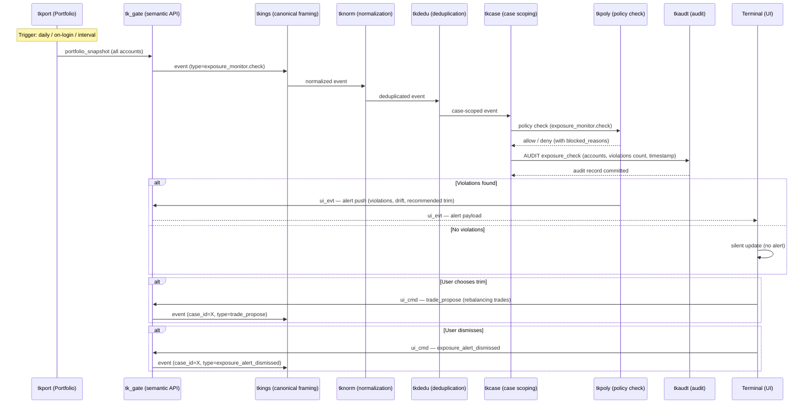

# UC-07: Portfolio Exposure Monitor — Alerts on Rule Violations

## Description

Portfolio exposure is periodically re-checked to detect when market movements push positions outside policy limits. The trigger can be:

1. **Daily schedule** — runs once per day at a configurable time.
2. **On login** — runs when the user opens the terminal UI.
3. **Continuous monitoring** — if the terminal never closes, runs at a fixed interval (e.g. every 5 minutes during market hours).

For each position, the monitor re-evaluates:
- **Per-position limit** — no more than 5% of portfolio in a single stock.
- **Per-sector limit** — no more than 20% of portfolio in a single sector.
- **Daily/monthly notional limits** — total trading activity caps.
- **Short-sale margin requirements** — for short positions.

If a violation is found, an alert is pushed to the terminal UI with:
- Which position(s) exceeded limits
- What changed (price movement, percentage drift)
- Which rules are violated
- A recommended trim action (which stocks to sell, which to buy to rebalance)

The user can **dismiss** (accept the risk) or **trim** (initiate rebalancing trades via UC-03/UC-05).

## Flow

## Tile Inventory

| Tile | Runtime ID | Responsibility | Status |
|------|-----------|----------------|--------|
| `tkport` | `tkport0` | Portfolio tile — read holdings with live prices, compute sector exposure, per-position percentages | **MISSING** — no tile exists (schema exists, see UC-03) |
| `tkpoly` | `tkpoly` | Policy tile — `exposure_monitor.check` capability envelope (per-position ≤ 5%, sector ≤ 20%, margin requirements) | **PARTIALLY** — exists, needs exposure monitoring policy rules |
| `tkaudt` | `tkaudt` | Audit tile — records `exposure_check` and `exposure_alert_dismissed` events | **PARTIALLY** — needs `exposure_check` record type |
| `tk_gate` | `tk_gate` | Semantic API tile — alert push via shared-memory event channel, user command intake via ui_cmd | **MISSING** |
| `tkmetr` | `metric` | Metrics tile — tracks exposure check latency, violation count | **EXISTING** |
| `tkdiag` | `tkdiag` | Diagnostics | **EXISTING** |

### What exists today (supporting)

- **`portfolio.BrokerageAccount`** — `Holding`, `AffordabilityResult`, five fixture accounts, `checkAffordability()`.
- **`trade_ticket.PolicyOutcome`** — `allow`, `deny`, `require_approval` enum.
- **`trade_ticket.BlockedReasonCode`** — `per_order_notional_exceeded`, etc.
- **`runInvestmentAgent`** — already calls `tkpoly` for policy checks.
- **`mock_adapter`** — canned `portfolio_snapshot` for test.
- **`mock_broker_market_server`** — serves `/quotes` with price data (needed for re-pricing positions).

### What's needed

1. Register `tkport` in tile registry — portfolio read tile with live price re-pricing.
2. Implement sector exposure computation: aggregate holdings by sector, compute percentage of total portfolio value.
3. Implement per-position percentage computation: `holding_value / total_portfolio_value`.
4. Add `exposure_monitor.check` capability to `tkpoly` — checks per-position (5%), per-sector (20%), margin requirements.
5. Add `exposure_check` record type to `tkaudt` — includes account IDs, violation count, list of violated positions.
6. Add `exposure_alert_dismissed` record type to `tkaudt` — includes dismissed violations, timestamp.
7. Implement alert generation: for each violation, compute drift (old percentage → new percentage), identify recommended trim trades.
8. Wire `tkport` into the investment workflow topology.
9. Implement alert channel: for each violation, compute drift (old percentage → new percentage), identify recommended trim trades, push via `tk_gate` event channel to terminal UI.

### System test approach

- Launch the exposure monitor topology with `tk_gate`, `tkings`, `tknorm`, `tkdedu`, `tkcase`, `tkpoly`, `tkport`, `tkaudt`, `metric`, `tkdiag`.
- Use `mock_adapter` with `technology_heavy` fixture (82% tech) — should trigger sector violation on every check.
- Use `mock_adapter` with `cash_rich` fixture — should pass all checks.
- Trigger on-demand check via `ui_cmd` channel (type=exposure_monitor.check).
- Verify: `tkport` returned holdings with correct price re-pricing; `tkpoly` applied per-position and sector limits; `tkings` canonicalized the event; `tkaudt` recorded `exposure_check` with violation list; terminal received alert payload with drift details and recommended trim trades via `ui_evt` channel.
- Test dismiss path: verify `exposure_alert_dismissed` is recorded.
- Test trim path: verify the recommended trades flow through UC-03/UC-05 (trade proposal).
- Replay test: captured capsule with substituted portfolio data produces identical alert output.
