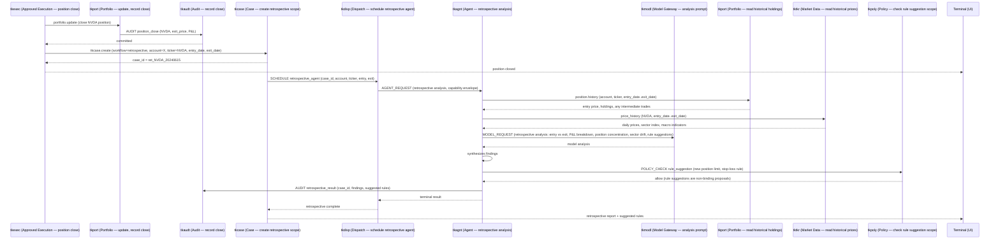

# UC-09: Trade Retrospective Analysis — Position Close Learning

## Description

When a position is closed (sold), a retrospective analysis event triggers. This is a **separate agent run** that evaluates the entire position journey — from entry to exit — and produces learning outputs: what went well, what didn't, and what rules should change.

This is different from UC-04 (execution) and UC-07 (exposure monitoring). Those answer "what happened right now." This answers "what happened over the whole hold period, and what should we do differently next time."

## Example

A user buys NVDA at $200, holds for 6 months, sells at $150. Loss of $10,000 on a 50% position.

The retrospective agent analyzes:
- Entry price vs exit price (-25%)
- Sector movement during hold period (Information Technology up +18% — this was an idiosyncratic loss)
- Position size relative to portfolio (50% — far above any sensible limit)
- Any policy checks that passed at entry but should have caught the size
- Whether stop-loss or trailing-stop logic existed (it didn't)

Output:
- **Finding:** "Single-position concentration at 50% was the dominant risk factor, not sector timing."
- **Rule suggestion:** "each_position_limit = min(5% of portfolio, $25,000 notional)"
- **Rule suggestion:** "add stop_loss_pct = 15% to all equity positions"
- These suggestions are logged as audit records and can be adopted into `tkpoly` policy

## Flow

## Tile Inventory

| Tile | Runtime ID | Responsibility | Status |
|------|-----------|----------------|--------|
| `tkexec` | `tkexec0` | Approved execution — closes position, triggers retrospective dispatch | **MISSING** — see UC-04 |
| `tkport` | `tkport0` | Portfolio tile — record position close, provide `position.history` (entry to exit data) | **MISSING** — see UC-03 |
| `tktkr` | `tktkr0` | Market data tile — read historical price data during hold period | **MISSING** — see UC-01 |
| `tkaudt` | `tkaudt` | Audit — records `position_close` and `retrospective_result` | **PARTIALLY** — needs record types |
| `tkcase` | `tkcase0` | Case — creates retrospective scope, groups entry data + analysis + rule suggestions | **PARTIALLY** — `tk_pass_stem.c` placeholder |
| `tkdisp` | `tkdisp` | Dispatch — schedules retrospective agent run | **EXISTING** — in investment workflow |
| `tkagnt` | `tkagnt` | Agent — runs retrospective analysis | **PARTIALLY** — needs `runRetrospectiveAgent` |
| `tkmodl` | `tkmodl` | Model gateway — routes analysis prompt | **EXISTING** — fixture/replay |
| `tkpoly` | `tkpoly` | Policy — validates rule suggestion scope (non-binding, must still be policy-checked) | **PARTIALLY** — needs `rule_suggestion` capability |
| `tkmetr` | `metric` | Metrics | **EXISTING** |
| `tkdiag` | `tkdiag` | Diagnostics | **EXISTING** |

### What exists today (supporting)

- **`portfolio.BrokerageAccount`** — `Holding`, `AffordabilityResult`, five fixture accounts.
- **`trade_ticket.TradeTicket`** — ticket with policy outcome, blocked reasons.
- **`trade_ticket.PaperExecutionResult`** — result type from paper execution.
- **`mock_adapter`** — canned `portfolio_snapshot`, `quote_snapshot`, `paper_order`.
- **`runInvestmentAgent`** — bounded investment agent (existing, needs retrospective variant).
- **`tk_pass_stem.c`** — placeholder stem for `tkcase`.

### What's needed

1. Implement `tkport.position.history` — return entry price, entry date, all intermediate holdings changes, exit price, exit date for a given account/ticker range.
2. Implement `tktkr.price_history` — return daily prices (and optionally sector index/macro data) for a ticker over a date range.
3. Register `tkcase` tile — create retrospective case scope with workflow=retrospective, account, ticker, entry_date, exit_date.
4. Implement `runRetrospectiveAgent` — bounded agent that:
   - Ingests position history (entry/exit prices, holdings changes)
   - Ingests market data (price history, sector movement)
   - Computes P&L breakdown (idiosyncratic vs systematic risk)
   - Evaluates position concentration relative to policy limits
   - Generates findings (what went well, what didn't)
   - Proposes rule suggestions (position limits, stop-loss, diversification)
5. Add `position_close` and `retrospective_result` record types to `tkaudt`.
6. Add `rule_suggestion` capability to `tkpoly` — validates that suggested rules stay within policy author scope (can't propose rules that expand beyond existing limits).
7. Wire `tkcase` into the retrospective topology and connect `tkdisp -> tkagnt` for the retrospective agent run.
8. Implement `tkexec` dispatch hook — after position close, trigger the retrospective agent via `tkdisp`.

## System test approach

- Launch the retrospective topology with `tkexec`, `tkport`, `tktkr`, `tkcase`, `tkdisp`, `tkagnt`, `tkmodl`, `tkpoly`, `tkaudt`, `metric`, `tkdiag`.
- Use `mock_adapter` with `technology_heavy` fixture (owns NVDA 50 shares at $200, sold at $150).
- Use `mock_model` for retrospective analysis with canned response.
- Use `tkbrok` default backend (always returns filled) to close position.
- Trigger via `ui_cmd` channel (type=trade_execute, close NVDA) to trigger the position close, which then triggers the retrospective dispatch.
- Verify: `tkport` recorded position close with correct P&L; `tkcase` created retrospective scope; `tkagnt` ran retrospective analysis and produced findings; `tkpoly` approved the rule suggestions (non-binding); `tkaudt` recorded `position_close` and `retrospective_result`; terminal received the report.
- Verify rule suggestion: suggested `each_position_limit = 5%` and `stop_loss_pct = 15%`.
- Test deny path: retrospective agent proposes a rule that would expand exposure (e.g., "increase position limit to 20%") — `tkpoly` should deny.

## Why replay is not involved

This is a **live agent run**, not a replay verification. The agent calls real (or stubbed) historical data sources, runs analysis through the model gateway, and produces new policy suggestions. Replay (`tkrepl`) is test infrastructure — it re-runs captured capsules with external effects disabled to verify deterministic behavior. This usecase doesn't need determinism verification; it needs genuine analysis of what happened and what to change next time.

If a replay test is needed for this usecase (to prove the retrospective output is deterministic given the same inputs), the existing `tkrepl` test infrastructure would apply — but that's a testing concern, not a product flow concern.
