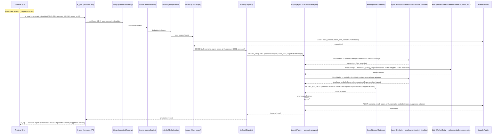

# UC-10: Portfolio Scenario Simulator — "What If" Risk Analysis

## Description

The user asks counterfactual questions about their portfolio:

1. **"What if QQQ drops 20%?"** — simulate the impact on the current portfolio given a hypothetical market move.
2. **"What if I had allocated 25% instead of 0.5% to each position?"** — rerun the current portfolio with different allocation weights to show the difference.
3. **"What if interest rates rise 100bps?"** — simulate portfolio impact given a macro shock.

This is a **scenario simulation**: the agent takes the user's current portfolio, applies hypothetical conditions, and shows the projected impact. It's not replaying past events — it's simulating futures that haven't happened.

Unlike Bloomberg or Interactive Brokers, which only show current state and basic risk metrics, this gives the user **counterfactual simulation** grounded in their actual portfolio with full policy, audit, and traceability.

## Flow

## Tile Inventory

| Tile | Runtime ID | Responsibility | Status |
|------|-----------|----------------|--------|
|| `tk_gate` | `tk_gate` | Semantic API tile — receives scenario_simulate via ui_cmd, routes to tkings, returns ui_rsp | **MISSING** |
| `tkcase` | `tkcase0` | Creates scenario scope | **PARTIALLY** — `tk_pass_stem.c` placeholder |
| `tkdisp` | `tkdisp` | Dispatches scenario agent | **EXISTING** — in investment workflow |
| `tkagnt` | `tkagnt` | Runs scenario analysis agent | **PARTIALLY** — needs `runScenarioAgent` |
| `tkmodl` | `tkmodl` | Model gateway for analysis | **EXISTING** — fixture/replay |
| `tkport` | `tkport0` | Portfolio — `portfolio.read` + `portfolio.simulate(holdings, scenario)` | **MISSING** — see UC-03 |
| `tktkr` | `tktkr0` | Market data — reference indices, rates, sector data for scenarios | **MISSING** — see UC-01 |
| `tkaudt` | `tkaudt` | Audit — records `scenario_result` | **PARTIALLY** — needs `scenario_result` record type |
| `tkmetr` | `metric` | Metrics | **EXISTING** |
| `tkdiag` | `tkdiag` | Diagnostics | **EXISTING** |

### What exists today (supporting)

- **`portfolio.BrokerageAccount`** — `Holding`, `AffordabilityResult`, five fixture accounts.
- **`portfolio.checkAffordability`** — affordability check logic.
- **`mock_adapter`** — canned `portfolio_snapshot`, `quote_snapshot`.
- **`mock_broker_market_server`** — HTTP stub for portfolio and quotes.

### What's needed

1. Implement `tkport.portfolio.simulate(holdings, scenario)` — takes current holdings and hypothetical parameters (e.g., "QQQ -20%", "rates +100bps"), computes new portfolio values, sector exposure, per-position impact, and total P&L.
2. Implement `tktkr.reference_data(scenario_type)` — returns reference indices, sector weights, rates, or other macro data needed to interpret the scenario (e.g., QQQ current price, SPY level, Treasury yield).
3. Implement `runScenarioAgent` — bounded agent that:
   - Reads current portfolio state
   - Reads reference data for the scenario
   - Runs `portfolio.simulate` with scenario parameters
   - Calls model for analysis (explain impact, identify drivers, suggest actions)
   - Produces a scenario report with before/after values and recommended actions
4. Add `scenario_result` record type to `tkaudt` — includes case_id, scenario description, before/after portfolio values, impact breakdown.
5. Implement `tk_gate` command handler for `scenario_simulate` via shared-memory channel — accepts scenario description and account ID.
6. Wire `tkcase` into the simulation topology.

### System test approach

- Launch the scenario simulation topology with `tk_gate`, `tkings`, `tknorm`, `tkdedu`, `tkcase`, `tkdisp`, `tkagnt`, `tkmodl`, `tkport`, `tktkr`, `tkaudt`, `tktool`, `tkadpt`, `metric`, `tkdiag`.
- Use `mock_adapter` with `technology_heavy` fixture (82% tech, owns GOOG/AMZN/NVDA).
- Use `mock_model` for scenario analysis with canned response.
- Send scenario_simulate command through `ui_cmd` channel (case_id=X, type=scenario_simulate, scenario=QQQ-20%, account_id=2001).
- Verify: `tkings` canonicalized the event; `tkcase` created scenario scope; `tkport` computed correct simulated portfolio values for QQQ -20% scenario; `tkagnt` ran analysis and produced findings; `tkaudt` recorded `scenario_result`; terminal received the report via `ui_rsp`.
- Verify impact: QQQ position shows ~-20% impact; total portfolio impact is weighted average of all tech positions affected by QQQ move.
- Test multiple scenarios: "rates +100bps", "tech sector -15%", "NVDA +30%".
