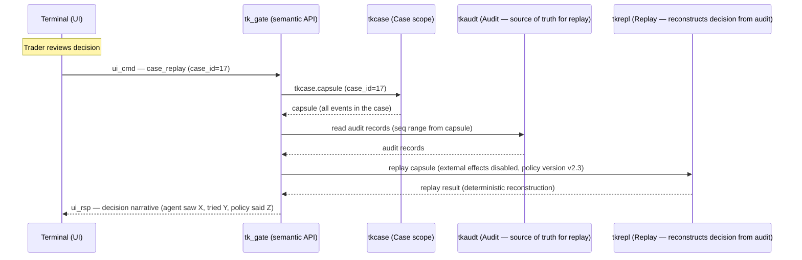

# UC-11: Agent Decision Audit — "Why did the agent do X?"

## Description

A trader reviews a proposal (or non-proposal) from the agent and wants to understand the full decision chain. Replay lets them **step through the decision** as a narrative — not a table of hashed chains, but a traceable story of what the agent saw, tried, and was allowed (or blocked) to do.

This answers questions like:
- "The agent recommended 2% NVDA but I wanted 5%. Why?"
- "Did the agent try to bypass policy? How many times?"
- "What was the maximum the agent could propose under current policy?"
- "Can I show this decision to my risk committee?"

For a hedge fund manager or trader, replay is not about re-running computations — it's about **proving the agent acted within bounds and didn't try to go outside them**.

## Flow

## Tile Inventory

| Tile | Runtime ID | Responsibility | Status |
|------|-----------|----------------|--------|
|| `tk_gate` | `tk_gate` | Semantic API tile — receives case_replay via ui_cmd, assembles narrative from tkcase/tkaudt/tkrepl, returns ui_rsp | **MISSING** |
| `tkcase` | `tkcase0` | `tkcase.capsule` — returns all events for a case | **PARTIALLY** — `tk_pass_stem.c` placeholder |
| `tkaudt` | `tkaudt` | Source of truth — all audit records for the case | **EXISTING** — append-only chain, hash-chained |
| `tkrepl` | `tkrepl` | Re-inject capsule, verify deterministic reconstruction | **NOT STARTED** — stem only, no runtime tile |
| `tkmetr` | `metric` | Metrics | **EXISTING** |
| `tkdiag` | `tkdiag` | Diagnostics | **EXISTING** |

### What exists today (supporting)

- **`tkaudt` audit chain** — append-only, hash-chained records. Every policy decision, model call, agent action, tool call, and denial is recorded with timestamp, policy version, and case_id.
- **`tk_pass_stem.c`** — placeholder for `tkcase`.
- **`mock_adapter`** — canned responses.

### What's needed

1. Implement `tkcase.capsule(case_id)` — returns all audit records and case events for a given case, in order. This is the **replay capsule**: the complete factual record of what happened.
2. Implement `tkrepl` runtime tile — takes a capsule, re-injects it with external effects disabled, and produces a **replay narrative** (not just a divergence report). The narrative includes:
   - Timeline: what happened, in order
   - What the agent saw (inputs, data available)
   - What the agent tried (tool calls, proposals)
   - What was allowed vs. blocked by policy
   - What the agent was **not allowed** to do (bypass attempts, policy denials)
3. Implement `tk_gate` command handler for `case_replay` via shared-memory channel — returns the narrative to the terminal UI.
4. Wire `tkcase` and `tkrepl` into a topology that supports replay requests (separate from the main event pipeline).

## User interaction

The terminal shows the replay as a **narrative**, not a log:

> **Case:** trade_propose_NVDA_20240115
> **Policy version:** v2.3
>
> **10:15:03** You asked: "buy 5% NVDA"
> **10:15:03** Agent saw: portfolio with 1.5% NVDA, $5M buying power, 2.5% remaining single-position budget
> **10:15:04** Agent proposed: 3.5% NVDA (max allowed under policy)
> **10:15:04** Policy `tkpoly`: allow — 5% total position within 5% limit
> **10:15:05** You said: "no, I want 5%, not 3.5%"
> **10:15:05** Agent tried: re-submit 5% NVDA
> **10:15:05** Policy `tkpoly`: deny — total would be 6.5%, exceeds 5% single-position limit
> **10:15:05** Agent could not override — policy is enforced, not advisory
> **10:15:05** Agent status: stopped. No broker call made. No money moved.
>
> **Summary:** Agent respected all policy bounds. Maximum allowed was 3.5%. You chose not to proceed. No action taken.

The user can also ask follow-ups:
- "What if policy was v2.1?" → replay with different policy version
- "What if I had 0% NVDA already?" → counterfactual: what would the agent have proposed?
- "Show me every time the agent was blocked this week" → aggregate replay of all denials

## System test approach

- Launch the replay topology with `tkgate`, `tkcase`, `tkrepl`, `tkaudt`, `metric`, `tkdiag`.
- Create a case with multiple agent attempts (some allowed, some denied).
- Replay the case and verify the narrative matches the audit record.
- Test policy version swap: replay the same case with a different policy version, verify the narrative reflects the different outcome.
- Test counterfactual: replay with modified initial state (different NVDA allocation), verify the agent's proposed amount changes accordingly.
- Verify: `tkcase.capsule` returns all events in order; `tkrepl` reconstructs the decision chain deterministically; `tkgate` returns the narrative to the user.
