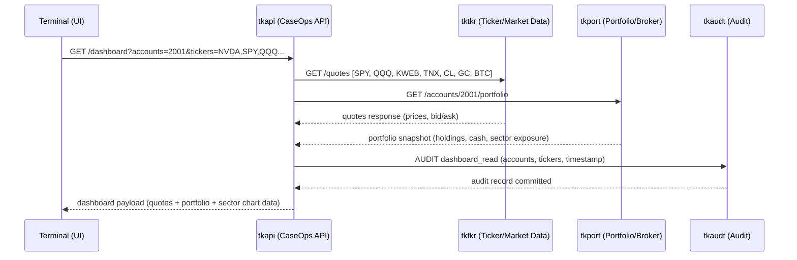

# UC-01: Terminal Data Dashboard

## Description

The user opens the terminal UI. The terminal requests:

1. **Portfolio data** — current holdings, cash balance, sector exposure (pre-aggregated), and account limits.
2. **Ticker data** — real-time prices, quotes, and market indicators for widgets: SPY, QQQ, KWEB, US Treasury rate, crude oil, gold, Bitcoin price, and other market benchmarks.

The request enters through the API tile (`tkapi`), which fans out to:

- A **market data tile** (`tktkr`) to fetch ticker prices and quotes from a market-data provider (stubbed).
- A **portfolio tile** (`tkport`) to read portfolio holdings from the brokerage account (stubbed).

Both data sources return to `tkapi`, which assembles and returns the dashboard payload to the terminal.

## Flow

## Tile Inventory

| Tile | Runtime ID | Responsibility | Status |
|------|-----------|----------------|--------|
| `tkapi` | `tkapi0` | HTTP/WebSocket CaseOps API tile — receives dashboard request, fans out to data tiles, returns assembled payload | **MISSING** — declared in `tile_ids.zig` but NOT in registry, NOT in topology, NOT implemented |
| `tktkr` | `tktkr0` | Market data tile — fetches ticker quotes, prices, market benchmarks from provider (stubbed for dev/test) | **MISSING** — no tile exists, no tile ID registered |
| `tkport` | `tkport0` | Portfolio/broker tile — reads holdings, cash, buying power, sector exposure from brokerage account (stubbed) | **MISSING** — no tile exists, no tile ID registered |
| `tkaudt` | `tkaudt` | Audit tile — records dashboard_read boundary event | **EXISTING** — implemented, fd_stem |
| `tkmetr` | `metric` | Metrics tile — tracks dashboard_read latency/count | **EXISTING** — delegated to Firedancer |
| `tkdiag` | `tkdiag` | Diagnostics — observes tile health | **EXISTING** — implemented, fd_stem |

### What exists today (supporting)

- **`portfolio` schema** (`src/tickoni/schema/portfolio/portfolio.zig`) — `BrokerageAccount`, `Holding`, `AffordabilityResult`, `findHolding()`, five fixture accounts, affordability checks.
- **`mock_broker_market_server`** (`src/tickoni/test/mocks/mock_broker_market_server.zig`) — HTTP server stub with `/health`, `/accounts/2001/portfolio`, `/quotes`, `/paper-orders` endpoints.
- **`mock_adapter`** (`src/tickoni/test/mocks/mock_adapter.zig`) — mock adapter backend with `portfolio_snapshot`, `quote_snapshot`, `paper_order` canned responses.

### What's needed

1. Register `tkapi` in the tile registry with HTTP service callbacks.
2. Register `tktkr` tile ID, implement market data fetch stub (returning canned quotes from the mock server or fixture data).
3. Register `tkport` tile ID, implement portfolio read stub (returning canned account snapshots).
4. Wire `tkapi` topology with channels to `tktkr`, `tkport`, and `tkaudt`.
5. Add `tkapi` HTTP handler that reads `/dashboard`, fans out to `tktkr` and `tkport`, assembles response.
6. Add audit record type `dashboard_read` to `tkaudt`.

### System test approach

- Launch the process-mode topology with `tkapi`, `tktkr`, `tkport`, `tkaudt`, `metric`, `tkdiag`.
- Use `mock_broker_market_server` to serve portfolio and quote data on a loopback port.
- Hit `tkapi`'s `/dashboard` endpoint (via an HTTP client in the test) with known ticker list.
- Verify: `tktkr` received the correct ticker list, returned matching quotes; `tkport` returned the correct portfolio for the requested account; `tkaudt` recorded the `dashboard_read` audit event; response contains expected fields.
- Replay test: replace live mock with captured capsule, verify identical output.
