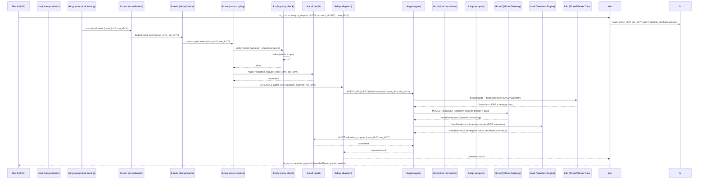

# UC-02: Valuation Analysis (NVDA)

## Description

The user asks the terminal to analyze a stock (e.g. NVDA). The event enters through `tkapi` (transport/auth), which sets the `case_id` and routes to the ingestion pipeline (`tkings`). The event flows through `tknorm` → `tkdedu` → `tkcase` (case scope created, `run_id` generated) → `tkpoly` (allowed) → `tkaudt`. `tkdisp` schedules the bounded valuation agent run (`tkagnt`), which calls the model gateway (`tkmodl`) through the tool normalizer (`tktool`) and adapter layer (`tkadpt`) to fetch financials (`tktkr`) and compute valuation (`tkval`).

## Flow

## Tile Inventory

|| Tile | Runtime ID | Responsibility | Status |
||------|-----------|----------------|--------|
|| `tkapi` | `tkapi` | HTTP/WebSocket CaseOps API tile — receives valuation request, sets case_id, routes to tkings | **MISSING** |
|| `tkings` | `tkings` | Universal event ingestion — receives valuation_analysis event, frames it canonically | **NOT STARTED** |
|| `tknorm` | `tknorm` | Canonical normalization — normalizes valuation_analysis event | **NOT STARTED** |
|| `tkdedu` | `tkdedu` | Deduplication — deduplicates valuation_analysis event | **NOT STARTED** |
|| `tkcase` | `tkcase0` | Case scoping — creates case scope, generates run_id for agent run | **PARTIALLY** — `tk_pass_stem.c` placeholder |
|| `tkpoly` | `tkpoly` | Policy check — `valuation_analysis.analyze` capability scope (allow within scope) | **PARTIALLY** — capability declared in capabilities.md but no policy rules yet |
|| `tkaudt` | `tkaudt` | Audit — records valuation_request and valuation_propose with case_id and run_id | **PARTIALLY** — needs valuation_request and valuation_propose record types |
|| `tkdisp` | `tkdisp` | Dispatch — schedules bounded valuation agent run | **EXISTING** — in investment workflow topology |
|| `tkagnt` | `tkagnt` | Bounded valuation agent — orchestrates data fetches, model call, computation | **PARTIALLY** — `runInvestmentAgent` exists for trading; needs runValuationAgent |
|| `tkmodl` | `tkmodl` | Model gateway — routes valuation analysis prompt to LLM, enforces budget/context limits | **EXISTING** — fixture/replay only, no provider I/O |
|| `tktool` | `tktool0` | Tool normalizer — normalizes agent tool requests (financials.fetch, valuation.compute) | **MISSING** |
|| `tkadpt` | `tkadpt0` | Adapter — routes tool requests to domain tiles (tkval, tktkr) | **MISSING** |
|| `tkval` | `tkval0` | DCF valuation engine — WACC, FCFF, Gordon Growth, exit-multiple cross-check, Monte Carlo | **MISSING** |
|| `tktkr` | `tktkr0` | Ticker/market data tile — fetches financials, ERP data, treasury rates (stubbed) | **MISSING** |
|| `tkmetr` | `metric` | Metrics tile — tracks valuation analysis latency/count | **EXISTING** |
|| `tkdiag` | `tkdiag` | Diagnostics | **EXISTING** |

### What exists today (supporting)

- **M4 milestone** (`doc/strategy/roadmap/milestones/m4.md`) — defines `tkval` tile scope: DCF engine, WACC, FCFF, Gordon Growth, exit-multiple cross-check, Monte Carlo, Damodaran methodology.
- **Valuation capabilities** (`capabilities.md` lines 441-455) — declares `valuation_market_data.read`, `valuation_financials.read`, `valuation_erps.read`, `valuation_analysis.analyze`, `valuation_analysis.propose`, `valuation_transcript.extract`, `valuation_peer.compare`, `valuation_reverse_dcf.analyze`, `valuation_sensitivity.analyze`, `valuation_conclusion.render`, `valuation_audit.check`.
- **Mock model backend** (`src/tickoni/test/mocks/mock_model.zig`) — canned model responses.
- **Mock broker market server** — can serve financial data if endpoints are defined.

### What's needed

1. Implement `tkval` tile with DCF methodology: WACC calculation, FCFF projection, Gordon Growth terminal value, exit-multiple cross-check, Monte Carlo simulation (native Zig, 100K+ iterations).
2. Register `tkval` in tile registry with proper link shape (request in, result out, audit link to `tkaudt`).
3. Implement `runValuationAgent` in `agent/` module — orchestrates financial data fetch, model call, and valuation computation.
4. Add `valuation_request` and `valuation_propose` record types to `tkaudt` audit schema.
5. Add valuation capability policy rules in `tkpoly`.
6. Wire `tkval` into the investment workflow topology.
7. Wire `tktool` and `tkadpt` into the analysis topology.

### System test approach

- Launch the full investment workflow topology extended with `tkval`.
- Use `mock_model` for model responses with canned valuation reasoning.
- Use `mock_broker_market_server` with financial data endpoints for financials, ERP, and treasury data.
- Send analyze_request through `ui_cmd` channel (case_id=X, type=valuation_analysis.analyze, ticker=NVDA).
- Verify: `tkval` computed DCF with correct WACC, FCFF, scenarios; `tkpoly` allowed the analysis; `tkaudt` recorded the `valuation_propose` with enterprise value range and scenario probabilities; replay with captured capsule produces identical output.
- Verify Monte Carlo: 100K iterations complete in <30s on single core (per M4 completion signal).
