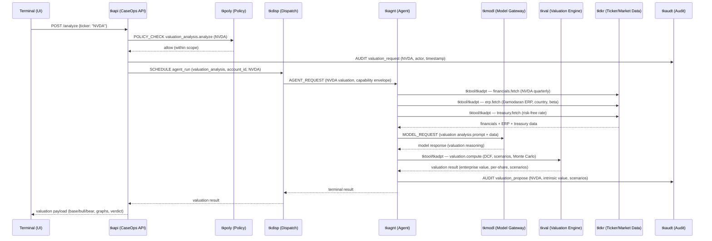

# UC-02: Valuation Analysis (NVDA)

## Description

The user asks the terminal to analyze a stock (e.g. NVDA). The event enters through the API tile and is routed to a **valuation agent** (conceptually called "Crane") that:

1. Fetches **quarterly financials** (income statement, balance sheet, cash flow).
2. Fetches **Damodaran ERP data** — equity risk premium, country risk premium, industry beta.
3. Fetches **treasury/risk-free rate** data.
4. Aggregates all data through `tkmodl` (model gateway) to produce a valuation (DCF with scenarios).
5. Returns the valuation to the terminal, which renders best/worst/base scenarios and graphs.

## Flow

## Tile Inventory

| Tile | Runtime ID | Responsibility | Status |
|------|-----------|----------------|--------|
| `tkapi` | `tkapi0` | Receives valuation request, routes to policy check, dispatches to agent | **MISSING** — declared in `tile_ids.zig` but NOT in registry, NOT in topology, NOT implemented |
| `tkval` | `tkval0` | DCF valuation engine — WACC, FCFF, Gordon Growth, exit-multiple cross-check, Monte Carlo, Damodaran methodology | **MISSING** — referenced in capabilities doc and M4 milestone, no tile ID registered, no tile exists |
| `tktkr` | `tktkr0` | Ticker/market data tile — fetches financials, ERP data, treasury rates (stubbed) | **MISSING** — see UC-01 |
| `tkpoly` | `tkpoly` | Policy check for `valuation_analysis.analyze` capability scope | **PARTIALLY** — capability declared in `capabilities.md` (P2 deferred) but no policy rules implemented yet |
| `tkdisp` | `tkdisp` | Schedules bounded valuation agent run | **EXISTING** — implemented, fd_stem |
| `tkagnt` | `tkagnt` | Bounded valuation agent — orchestrates data fetches, model call, computation | **PARTIALLY** — `runInvestmentAgent` exists for trading; needs `runValuationAgent` |
| `tkmodl` | `tkmodl` | Model gateway — routes valuation analysis prompt to LLM, enforces budget/context limits | **EXISTING** — fixture/replay only, no provider I/O |
| `tkaudt` | `tkaudt` | Audit tile — records valuation_request and valuation_propose events | **PARTIALLY** — exists, needs `valuation_request` and `valuation_propose` record types |
| `tkmetr` | `metric` | Metrics tile — tracks valuation analysis latency/count | **EXISTING** |
| `tkdiag` | `tkdiag` | Diagnostics | **EXISTING** |

### What exists today (supporting)

- **M4 milestone** (`doc/strategy/roadmap/milestones/m4.md`) — defines `tkval` tile scope: DCF engine, WACC, FCFF, Gordon Growth, exit-multiple cross-check, Monte Carlo, Damodaran methodology.
- **Valuation capabilities** (`capabilities.md` lines 441-455) — declares `valuation_market_data.read`, `valuation_financials.read`, `valuation_erps.read`, `valuation_analysis.analyze`, `valuation_analysis.propose`, `valuation_transcript.extract`, `valuation_peer.compare`, `valuation_reverse_dcf.analyze`, `valuation_sensitivity.analyze`, `valuation_conclusion.render`, `valuation_audit.check`.
- **Mock model backend** (`src/tickoni/test/mocks/mock_model.zig`) — canned model responses.
- **Mock broker market server** — can serve financial data if endpoints are defined.

### What's needed

1. Implement `tkval` tile with DCF methodology: WACC calculation, FCFF projection, Gordon Growth terminal value, exit-multiple cross-check, Monte Carlo simulation (native Zig, 100K+ iterations).
2. Register `tkval` in tile registry with proper link shape (request in, result out, audit link to `tkaudt`).
3. Implement `runValuationAgent` in `agent/` module — orchestrates financial data fetch, model call, and valuation computation.
4. Add `valuation_request` and `valuation_propose` record types to `tkaudt` audit schema.
5. Add valuation capability policy rules in `tkpoly`.
6. Wire `tkval` into the investment workflow topology.
7. Implement `tkapi` HTTP handler for `/analyze` (see UC-01).

### System test approach

- Launch the full investment workflow topology extended with `tkval`.
- Use `mock_model` for model responses with canned valuation reasoning.
- Use `mock_broker_market_server` with financial data endpoints for financials, ERP, and treasury data.
- Send `/analyze?ticker=NVDA` through `tkapi`.
- Verify: `tkval` computed DCF with correct WACC, FCFF, scenarios; `tkpoly` allowed the analysis; `tkaudt` recorded the `valuation_propose` with enterprise value range and scenario probabilities; replay with captured capsule produces identical output.
- Verify Monte Carlo: 100K iterations complete in <30s on single core (per M4 completion signal).
