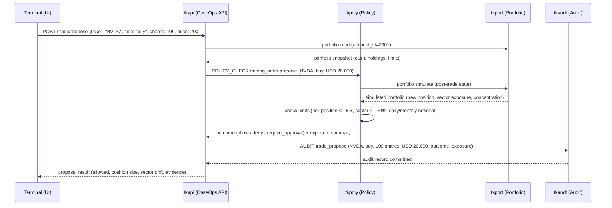

# UC-03: Trade Proposal — Buy NVDA

## Description

The user decides to buy 100 shares of NVDA at $200/share. The event enters through the API tile and flows through:

1. **Affordability check** — verifies the user has enough cash/buying power.
2. **Portfolio change simulation** — calculates what the portfolio would look like after the trade (new holdings, sector exposure, position concentration).
3. **Policy validation** — checks against rules:
   - No more than 5% of portfolio in a single stock.
   - No more than 20% of portfolio in a single sector.
   - Daily/monthly notional limits.
   - Open-order slot limits.
4. **Exposure summary returned** — the terminal displays the proposed position, updated exposure, and whether the trade is allowed, denied, or requires approval.

No money moves. This is a **proposal-only** flow (agents are proposal-first per framework invariants).

## Flow

## Tile Inventory

| Tile | Runtime ID | Responsibility | Status |
|------|-----------|----------------|--------|
| `tkapi` | `tkapi0` | Receives trade proposal, validates request shape, routes to policy | **MISSING** — declared in `tile_ids.zig` but NOT in registry, NOT in topology, NOT implemented |
| `tkport` | `tkport0` | Portfolio tile — reads current holdings, simulates post-trade state, computes sector exposure | **MISSING** — no tile exists (schema exists, see below) |
| `tkpoly` | `tkpoly` | Policy tile — checks trading capability envelope (per-position limit, sector limit, notional limits) | **PARTIALLY** — exists, implements basic allow/deny for payment; needs trading capability rules |
| `tkaudt` | `tkaudt` | Audit tile — records `trade_propose` boundary event with exposure | **PARTIALLY** — exists, needs `trade_propose` record type |
| `tkmetr` | `metric` | Metrics tile — tracks trade proposal latency/count | **EXISTING** |
| `tkdiag` | `tkdiag` | Diagnostics | **EXISTING** |

### What exists today (supporting)

- **`portfolio` schema** (`src/tickoni/schema/portfolio/portfolio.zig`) — `BrokerageAccount`, `Holding`, `AffordabilityResult`, `checkAffordability()`, five fixture accounts.
- **`trade_ticket` schema** (`src/tickoni/schema/consumer_money/trade_ticket.zig`) — `TradeTicket`, `QuoteSnapshot`, `PaperExecutionResult`, `PolicyOutcome`, `BlockedReasonCode`, `buildMarketBuyTicket()`.
- **`runInvestmentAgent`** (`src/tickoni/tiles/agent/mod.zig`) — bounded investment agent that calls portfolio read, quote read, builds trade ticket, applies policy guardrails.
- **Mock adapter** (`src/tickoni/test/mocks/mock_adapter.zig`) — canned `portfolio_snapshot` and `quote_snapshot`.
- **Investment workflow topology** (`src/app/tickoni/topologies.zig`) — 14-tile topology with `tkcase`, `tkdisp`, `tkagnt`, `tkmodl`, `tktool`, `tkadpt`.

### What's needed

1. Register `tkport` in tile registry — portfolio read and simulation tile.
2. Implement `tkport` tile process: `portfolio.read` adapter call returns `BrokerageAccount`; `portfolio.simulate` computes post-trade state (new holdings array, sector exposure, position concentration).
3. Implement sector exposure computation: aggregate holdings by sector, compute percentages.
4. Add per-position (5%) and per-sector (20%) policy rules to `tkpoly`.
5. Add `trade_propose` record type to `tkaudt` — includes ticker, side, shares, price, notional, outcome, position size, sector drift.
6. Wire `tkport` into investment workflow topology.
7. Implement `tkapi` handler for `/trade/propose` (see UC-01).

### System test approach

- Launch the full investment workflow topology extended with `tkport`.
- Use `mock_adapter` with `cash_rich` fixture (account 2001, $5M buying power).
- Send `/trade/propose?ticker=NVDA&shares=100&price=200` through `tkapi`.
- Verify: `tkport` returned correct portfolio; `tkpoly` applied per-position and sector limits; `tkaudt` recorded `trade_propose` with exposure data; terminal receives the proposal result.
- Test deny path: use `technology_heavy` fixture (already 82% tech) — sector limit should trigger.
- Test approval-required path: notional exceeds per-order limit but below daily limit.
- Replay test: captured capsule with substituted portfolio and policy decisions should produce identical output.
