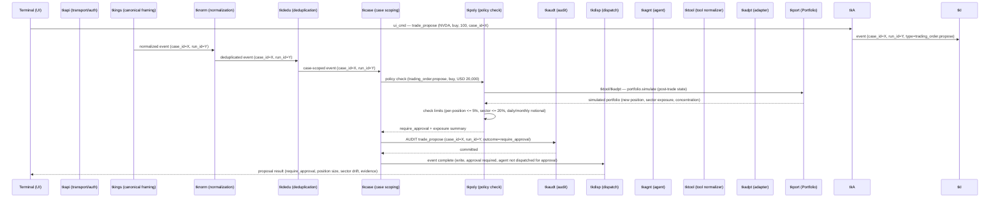

# UC-03: Trade Proposal — Buy NVDA

## Description

The user decides to buy 100 shares of NVDA at $200/share. The event enters through `tkapi` (transport/auth), which sets the `case_id` and routes to the ingestion pipeline (`tkings`). The event flows through `tknorm` → `tkdedu` → `tkcase` (case scope created, `run_id` generated) → `tkpoly` (policy check — trading_order.propose: require_approval for trades) → `tkaudt`. `tkdisp` schedules the bounded agent run (`tkagnt`), which calls portfolio read and policy simulation through the tool normalizer (`tktool`) and adapter layer (`tkadpt`) to the portfolio tile (`tkport`).

No money moves. This is a **proposal-only** flow (agents are proposal-first per framework invariants).

## Flow

## Tile Inventory

|| Tile | Runtime ID | Responsibility | Status |
||------|-----------|----------------|--------|
|| `tkapi` | `tkapi0` | HTTP/WebSocket CaseOps API tile — receives trade proposal request, sets case_id, routes to tkings | **MISSING** |
|| `tkings` | `tkings` | Universal event ingestion — receives trading_order.propose event, frames it canonically | **NOT STARTED** |
|| `tknorm` | `tknorm` | Canonical normalization — normalizes trade proposal event into canonical facts | **NOT STARTED** |
|| `tkdedu` | `tkdedu` | Deduplication — deduplicates trade proposal event | **NOT STARTED** |
|| `tkcase` | `tkcase0` | Case scoping — creates case scope, generates run_id for agent run | **PARTIALLY** — `tk_pass_stem.c` placeholder |
|| `tkpoly` | `tkpoly` | Policy check — `trading_order.propose` capability envelope (require_approval for trades) | **PARTIALLY** — exists, needs trading capability rules |
|| `tkaudt` | `tkaudt` | Audit — records trade_propose boundary event with case_id, run_id, outcome | **PARTIALLY** — needs trade_propose record type |
|| `tkdisp` | `tkdisp` | Dispatch — handles write events requiring approval (no agent dispatch for proposal) | **EXISTING** — in investment workflow topology |
|| `tkmetr` | `metric` | Metrics tile — tracks trade proposal latency/count | **EXISTING** |
|| `tkdiag` | `tkdiag` | Diagnostics | **EXISTING** |
|| `tkport` | `tkport0` | Portfolio tile — reads current holdings, simulates post-trade state, computes sector exposure | **MISSING** |
|| `tktool` | `tktool0` | Tool normalizer — normalizes portfolio.simulate tool request | **MISSING** |
|| `tkadpt` | `tkadpt0` | Adapter — routes tool requests to tkport | **MISSING** |

### What exists today (supporting)

- **`portfolio` schema** (`src/tickoni/schema/portfolio/portfolio.zig`) — `BrokerageAccount`, `Holding`, `AffordabilityResult`, `checkAffordability()`, five fixture accounts.
- **`trade_ticket` schema** (`src/tickoni/schema/consumer_money/trade_ticket.zig`) — `TradeTicket`, `QuoteSnapshot`, `PaperExecutionResult`, `PolicyOutcome`, `BlockedReasonCode`, `buildMarketBuyTicket()`.
- **`runInvestmentAgent`** (`src/tickoni/tiles/agent/mod.zig`) — bounded investment agent that calls portfolio read, quote read, builds trade ticket, applies policy guardrails.
- **Mock adapter** (`src/tickoni/test/mocks/mock_adapter.zig`) — canned `portfolio_snapshot` and `quote_snapshot`.
- **Investment workflow topology** (`src/app/tickoni/topologies.zig`) — 14-tile topology with `tkcase`, `tkdisp`, `tkagnt`, `tkmodl`, `tktool`, `tkadpt`.

### What's needed

1. Register `tkport` in tile registry — portfolio read and simulation tile.
2. Implement `tkport` tile process: `portfolio.read` adapter call returns `BrokerageAccount`; `portfolio.simulate` computes post-trade state (new holdings array, sector exposure, position concentration).
3. Implement sector exposure computation: aggregate holdings by sector, compute percentages.
4. Add per-position (5%) and per-sector (20%) policy rules to `tkpoly`.
5. Add `trade_propose` record type to `tkaudt` — includes ticker, side, shares, price, notional, outcome, position size, sector drift.
6. Wire `tkport` into investment workflow topology.
7. Implement `tk_api` command handler for `trade_propose` via shared-memory channel.

### System test approach

- Launch the full investment workflow topology extended with `tkport`, `tk_api`, `tkings`, `tknorm`, `tkdedu`, `tkcase`, `tkpoly`, `tkaudt`, `tktool`, `tkadpt`.
- Use `mock_adapter` with `cash_rich` fixture (account 2001, $5M buying power).
- Send trade_propose command through `ui_cmd` channel (case_id=X, type=trading_order.propose, ticker=NVDA).
- Verify: `tkport` returned correct portfolio; `tkpoly` applied per-position and sector limits; `tkaudt` recorded `trade_propose` with exposure data; terminal receives the proposal result.
- Test deny path: use `technology_heavy` fixture (already 82% tech) — sector limit should trigger.
- Test approval-required path: notional exceeds per-order limit but below daily limit.
- Replay test: captured capsule with substituted portfolio and policy decisions should produce identical output.
