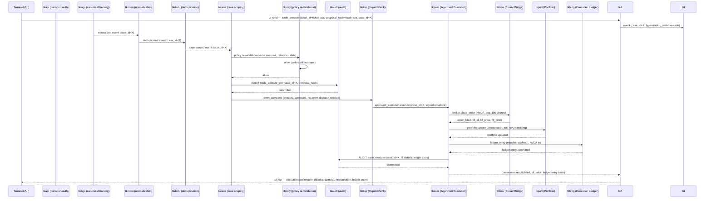

# UC-04: Trade Execution — Buy Confirmation

## Description

The user reviews the trade proposal from UC-03 and agrees. The event enters through `tkapi` (transport/auth), which sets the `case_id` and routes to the ingestion pipeline (`tkings`). The event flows through `tknorm` → `tkdedu` → `tkcase` (case scope created) → `tkpoly` (re-validation: policy still in scope) → `tkaudt` → `tkexec` (approved execution) → `tkbrok` (broker) → `tkport` (portfolio update) → `tkledg` (ledger entry) → `tkaudt` (execution audit).

This is the first path where money would actually move (in production). In the current stubbed environment, the broker returns a synthetic filled order.

## Flow

## Tile Inventory

|| Tile | Runtime ID | Responsibility | Status |
||------|-----------|----------------|--------|
|| `tkapi` | `tkapi` | HTTP/WebSocket CaseOps API tile — receives trade execution request, sets case_id, routes to tkings | **MISSING** |
|| `tkings` | `tkings` | Universal event ingestion — receives trading_order.execute event, frames it canonically | **NOT STARTED** |
|| `tknorm` | `tknorm` | Canonical normalization — normalizes trade execution event into canonical facts | **NOT STARTED** |
|| `tkdedu` | `tkdedu` | Deduplication — deduplicates trade execution event | **NOT STARTED** |
|| `tkcase` | `tkcase0` | Case scoping — creates case scope for execution, links to proposal case | **PARTIALLY** — `tk_pass_stem.c` placeholder |
|| `tkpoly` | `tkpoly` | Policy re-validation — `trading_order.execute` capability scope (allow if policy still in scope) | **PARTIALLY** — needs execution-specific policy path |
|| `tkaudt` | `tkaudt` | Audit — records trade_execute_pre and trade_execute boundary events with case_id | **PARTIALLY** — needs trade_execute record type |
|| `tkexec` | `tkexec0` | Approved execution tile — privileged mutation path, enforces signed action envelope, calls broker, updates portfolio, posts ledger entry | **MISSING** |
|| `tkbrok` | `tkbrok` | Broker bridge tile — routes broker requests (place, cancel, query) to per-account broker implementations via vtable interface | **MISSING** — registered in tile_ids.zig but not in registry, not in topology, not implemented |
|| `tkport` | `tkport0` | Portfolio tile — update holdings and cash after execution | **MISSING** — see UC-03 |
|| `tkledg` | `tkledg0` | Execution ledger tile — stores balances, transfers, fills, accounting entries | **MISSING** — TigerBeetle is the authoritative finance database per AGENTS.md; no tile ID registered yet |
|| `tkmetr` | `metric` | Metrics tile | **EXISTING** |
|| `tkdiag` | `tkdiag` | Diagnostics | **EXISTING** |

### What exists today (supporting)

- **`mock_broker_market_server`** (`src/tickoni/test/mocks/mock_broker_market_server.zig`) — serves `/paper-orders` returning `paper_order_id` and status `filled`.
- **`mock_adapter`** — canned `paper_order` response.
- **`runInvestmentAgent`** — produces `PaperExecutionResult` when policy allows.
- **`trade_ticket.PaperExecutionResult`** — result type from paper execution.
- **`portfolio.BrokerageAccount`** — schema for holding/cash state.

### What's needed

1. Register `tkbrok` in tile registry — broker bridge tile. Follows the `tkmodl` pattern: a type-erased vtable interface (`BrokerBackend`) that dispatches to pluggable broker implementations (IBKR, Schwab, SnapTrade, etc.). Only the brokers the user has accounts with are instantiated per instance. For dev/test, the default backend always returns filled.
2. Implement `tkbrok` tile process: `broker.place_order` normalizes the request, looks up the broker implementation from the account's broker config, calls the broker's `call()` method, returns the result. Each broker kind is a separate instance (like `tkmodl` instances).
3. Implement the vtable interface for broker backends: `BrokerBackend` with `call()` accepting normalized broker requests (place_order, cancel_order, query_position, get_quotes) and returning results. Each broker (IBKR, Schwab, SnapTrade) implements `call()`.
4. Register `tkexec` in tile registry — approved execution tile with privileged mutation path.
5. Implement `tkexec` tile process: verifies signed action envelope, calls `tkbrok` via adapter, updates portfolio, posts ledger entry, records audit trail.
6. Register `tkledg` tile ID — execution ledger tile (stores transfers, fills, balances). TigerBeetle integration for production; local in-memory store for dev/test.
7. Implement portfolio mutation: deduct cash, add/update holding, update open-order count, update daily/monthly notional used.
8. Implement ledger entry: transfer record with before/after state for audit read-back reconciliation.
9. Add `trade_execute` record type to `tkaudt` — includes proposal hash, fill details, ledger entry hash, signed envelope verification.
10. Wire `tkexec`, `tkbrok`, `tkledg` into a new execution topology.
11. Implement `tk_api` command handler for `trade_execute` via shared-memory channel.

### System test approach

- Launch the execution topology with `tk_api`, `tkings`, `tknorm`, `tkdedu`, `tkcase`, `tkpoly`, `tkexec`, `tkbrok`, `tkledg`, `tkport`, `tkaudt`, `tktool`, `tkadpt`, `metric`, `tkdiag`.
- Use `mock_adapter` with portfolio snapshot and paper_order filled response.
- Use `tkbrok` default backend (always returns filled).
- Send trade_execute command through `ui_cmd` channel (case_id=X, type=trading_order.execute, ticket_id=ticket_abc, proposal_hash=hash_xyz).
- Verify: `tkexec` verified the signed envelope; `tkbrok` returned filled via default backend; `tkport` updated holdings and cash; `tkledg` posted the transfer entry; `tkaudt` recorded `trade_execute` with fill details and ledger hash.
- Verify replay: replace `tkbrok` and `tkledg` with capsule substitutes, verify identical execution result.
- Verify deny path: send execution with invalid/expired proposal hash — `tkexec` should deny before calling broker.
