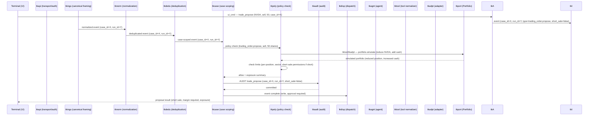

# UC-05: Trade Proposal — Sell (including short)

## Description

The user decides to sell. The event enters through `tkapi` (transport/auth), which sets the `case_id` and routes to the ingestion pipeline (`tkings`). The event flows through `tknorm` → `tkdedu` → `tkcase` (case scope created, `run_id` generated) → `tkpoly` (policy check — `trading_order.propose`: for long sell, allow; for short sell, check margin) → `tkaudt`. `tkdisp` schedules the bounded agent run (`tkagnt`), which calls portfolio read and simulation through the tool normalizer (`tktool`) and adapter layer (`tkadpt`) to the portfolio tile (`tkport`).

This is also proposal-only — no shares actually move. The policy gate determines if shorting is allowed for this account.

## Flow

## Tile Inventory

|| Tile | Runtime ID | Responsibility | Status |
||------|-----------|----------------|--------|
|| `tkapi` | `tkapi` | HTTP/WebSocket CaseOps API tile — receives trade proposal request, sets case_id, routes to tkings | **MISSING** |
|| `tkings` | `tkings` | Universal event ingestion — receives trading_order.propose (sell) event, frames it canonically | **NOT STARTED** |
|| `tknorm` | `tknorm` | Canonical normalization — normalizes sell trade proposal event into canonical facts | **NOT STARTED** |
|| `tkdedu` | `tkdedu` | Deduplication — deduplicates sell trade proposal event | **NOT STARTED** |
|| `tkcase` | `tkcase0` | Case scoping — creates case scope, generates run_id for agent run | **PARTIALLY** — `tk_pass_stem.c` placeholder |
|| `tkpoly` | `tkpoly` | Policy check — `trading_order.propose` with short-sale capability (check short-sale permissions, margin requirements) | **MISSING** — no short-sale capability rules exist |
|| `tkaudt` | `tkaudt` | Audit — records trade_propose with short_sale flag and case_id | **PARTIALLY** — needs short_sale field in trade_propose record |
|| `tkdisp` | `tkdisp` | Dispatch — handles write events requiring approval | **EXISTING** — in investment workflow topology |
|| `tkmetr` | `metric` | Metrics tile | **EXISTING** |
|| `tkdiag` | `tkdiag` | Diagnostics | **EXISTING** |
|| `tkport` | `tkport0` | Portfolio tile — simulate post-trade state including short positions and margin | **MISSING** — see UC-03 |
|| `tktool` | `tktool0` | Tool normalizer — normalizes portfolio.simulate tool request | **MISSING** |
|| `tkadpt` | `tkadpt0` | Adapter — routes tool requests to tkport | **MISSING** |

### What exists today (supporting)

- **`portfolio.Side`** — enum with `buy` and `sell` variants only.
- **`portfolio.Holding`** — `share_count` is unsigned (u32); no short position concept.
- **`trade_ticket`** — `QuoteSnapshot` exists; `PaperExecutionResult` exists.

### What's needed

1. Extend `portfolio.Side` enum to include `sell_short` variant.
2. Extend `portfolio.Holding` to support negative share counts (or add a `ShortHolding` variant).
3. Add `margin_cents` and `margin_required_cents` fields to `BrokerageAccount`.
4. Add `short_sale_allowed` capability dimension to `tkpoly` policy scope.
5. Implement short-sale policy check: margin requirement >= X% of position value, locate availability check, single-stock short limit.
6. Add `short_sale` boolean to `trade_propose` audit record in `tkaudt`.
7. Wire `tkport` to simulate short position creation (negative holding, margin commitment).
8. Implement `tk_api` command handler for `trade_propose` (short-sale variant) via shared-memory channel.

### System test approach

- Launch the trade proposal topology with `tk_api`, `tkings`, `tknorm`, `tkdedu`, `tkcase`, `tkpoly`, `tkport`, `tkaudt`, `tktool`, `tkadpt`, `metric`, `tkdiag`.
- Test 1 (long sell): send `trade_propose` (sell, not short-sale) via `ui_cmd` channel through `tk_api` → `tkings` → `tknorm` → `tkdedu` → `tkcase` → `tkpoly` → `tkaudt`; use `technology_heavy` fixture (owns NVDA 115 shares); propose sell 50 shares. Verify: `tkpoly` allows, `tkport` simulates reduced NVDA + increased cash, `tkaudt` records `trade_propose` with `short_sale=false`.
- Test 2 (short sell): use `diversified` fixture (no NVDA holding); send `trade_propose` (sell_short) via `ui_cmd` channel. Verify: `tkpoly` checks short-sale permissions and margin; if margin insufficient, returns deny; if allowed, returns proposal with short position and margin requirement.
- Test 3 (short sell denied): use `low_cash` fixture — margin check should fail, policy denies.
- Replay test: capsule with substituted portfolio and policy decisions produces identical output.
