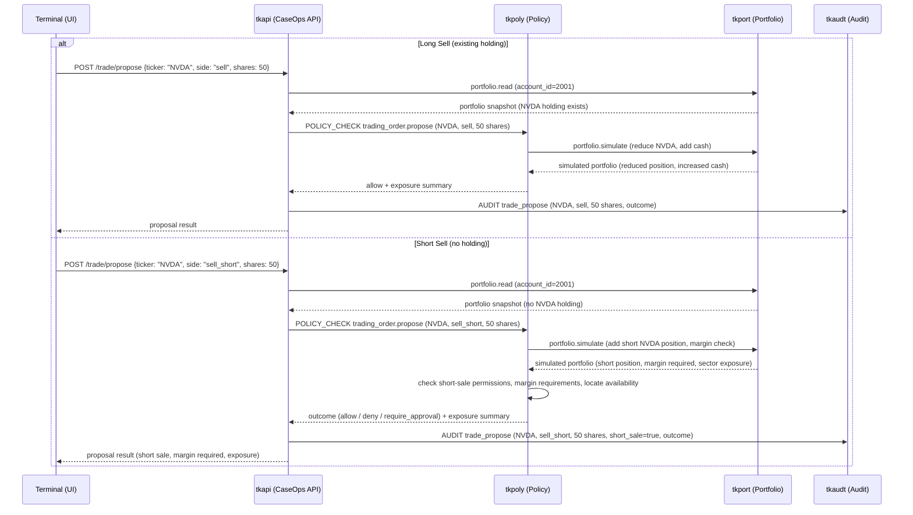

# UC-05: Trade Proposal — Sell (including short)

## Description

The user decides to sell. The flow mirrors UC-03 but with critical differences:

1. The user may be **selling existing holdings** (long) or **shorting** (selling borrowed shares).
2. **Short-sale validation** — the policy must check short-sale permissions, margin requirements, and locate availability.
3. **Exposure update** — for short sales, the portfolio gains a negative position; sector exposure and net exposure change.
4. The proposal returns updated exposure information to the terminal for verification and approval.

This is also proposal-only — no shares actually move. The policy gate determines if shorting is allowed for this account.

## Flow

## Tile Inventory

| Tile | Runtime ID | Responsibility | Status |
|------|-----------|----------------|--------|
| `tkapi` | `tkapi0` | Receives trade proposal, distinguishes long vs short, routes to policy | **MISSING** |
| `tkport` | `tkport0` | Portfolio tile — simulate post-trade state including short positions and margin | **MISSING** |
| `tkpoly` | `tkpoly` | Policy tile — check short-sale permissions, margin requirements | **MISSING** — no short-sale capability rules exist |
| `tkaudt` | `tkaudt` | Audit tile — records `trade_propose` with `short_sale` flag | **PARTIALLY** — needs short_sale field in `trade_propose` record |
| `tkmetr` | `metric` | Metrics tile | **EXISTING** |
| `tkdiag` | `tkdiag` | Diagnostics | **EXISTING** |

### What exists today (supporting)

- **`portfolio.Side`** — enum with `buy` and `sell` variants only.
- **`portfolio.Holding`** — `share_count` is unsigned (u32); no short position concept.
- **`trade_ticket`** — `QuoteSnapshot` exists; `PaperExecutionResult` exists.

### What's needed

1. Extend `portfolio.Side` enum to include `sell_short` variant.
2. Extend `portfolio.Holding` to support negative share counts (or add a `ShortHolding` variant).
3. Add `margin_cents` and `margin_required_cents` fields to `BrokerageAccount`.
4. Add `short_sale_allowed` capability dimension to `tkpoly` policy scope.
5. Implement short-sale policy check: margin requirement >= X% of position value, locate availability check, single-stock short limit.
6. Add `short_sale` boolean to `trade_propose` audit record in `tkaudt`.
7. Wire `tkport` to simulate short position creation (negative holding, margin commitment).
8. Wire `tkapi` handler for `/trade/propose` with short-sale routing.

### System test approach

- Launch the trade proposal topology with `tkapi`, `tkport`, `tkpoly`, `tkaudt`, `metric`, `tkdiag`.
- Test 1 (long sell): use `technology_heavy` fixture (owns NVDA 115 shares); propose sell 50 shares. Verify: `tkpoly` allows, `tkport` simulates reduced NVDA + increased cash, `tkaudt` records `trade_propose` with `short_sale=false`.
- Test 2 (short sell): use `diversified` fixture (no NVDA holding); propose sell_short 50 shares. Verify: `tkpoly` checks short-sale permissions and margin; if margin insufficient, returns deny; if allowed, returns proposal with short position and margin requirement.
- Test 3 (short sell denied): use `low_cash` fixture — margin check should fail, policy denies.
- Replay test: capsule with substituted portfolio and policy decisions produces identical output.
