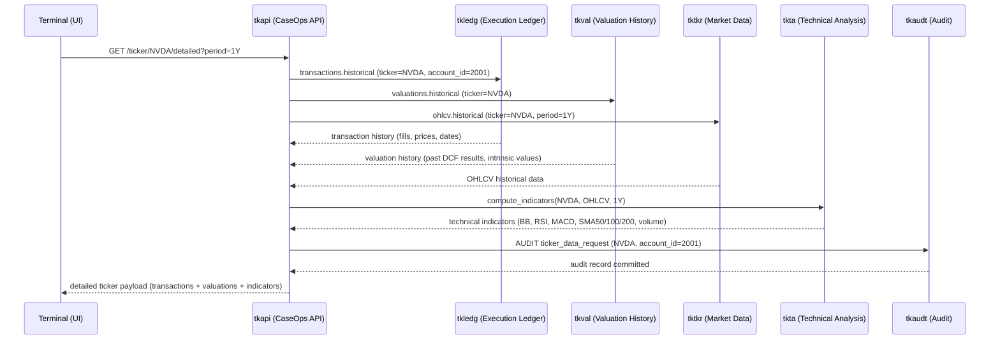

# UC-06: Detailed Ticker Data Request

## Description

The user requests detailed historical data for a ticker (e.g. NVDA). The backend assembles:

1. **Historical transaction data** — past fills, executed orders, from the execution ledger.
2. **Historical evaluation results** — past valuation analyses performed on this ticker (from `tkval`).
3. **Technical analysis indicators** — computed from historical OHLCV market data:
   - **Bollinger Bands** (20-period SMA, 2.0 standard deviations, EMA)
   - **RSI** (14-period)
   - **Volume** (period chart)
   - **MACD** (12-period EMA, 26-period EMA, 9-period EMA signal line)
   - **SMA** (50, 100, 200-period simple moving averages)

The request enters through the API tile, which fans out to:
- The **execution ledger** (`tkledg`) for historical transaction data.
- The **valuation store** (`tkval` or a valuation history tile) for past analyses.
- The **market data tile** (`tktkr`) for historical OHLCV data.
- The **technical analysis engine** (`tkta`) for computing indicators from OHLCV.

## Flow

## Tile Inventory

| Tile | Runtime ID | Responsibility | Status |
|------|-----------|----------------|--------|
| `tkapi` | `tkapi0` | Receives ticker data request, fans out to ledger/valuation/market data | **MISSING** |
| `tkledg` | `tkledg0` | Execution ledger tile — historical transaction query (fills, prices, dates) | **MISSING** — see UC-04 |
| `tkval` | `tkval0` | Valuation tile — past valuation history for a ticker | **MISSING** — see UC-02 |
| `tktkr` | `tktkr0` | Market data tile — historical OHLCV data | **MISSING** — see UC-01 |
| `tkta` | `tkta0` | Technical analysis engine — computes Bollinger Bands, RSI, MACD, SMA, Volume from OHLCV | **MISSING** — no tile ID registered, no analysis engine exists |
| `tkaudt` | `tkaudt` | Audit tile — records `ticker_data_request` boundary event | **PARTIALLY** — needs `ticker_data_request` record type |
| `tkmetr` | `metric` | Metrics tile | **EXISTING** |
| `tkdiag` | `tkdiag` | Diagnostics | **EXISTING** |

### What exists today (supporting)

- **`mock_broker_market_server`** — serves `/quotes` and `/paper-orders` but NOT historical OHLCV endpoints.
- **`mock_model`** — canned model responses (not applicable for TA).
- **No technical analysis library** — Bollinger Bands, RSI, MACD, SMA, Volume are standard financial formulas with no external dependency required.

### What's needed

1. Register `tkta` in tile registry — technical analysis engine.
2. Implement `tkta` tile: pure computation engine (no external I/O), takes OHLCV data as input, computes:
   - **Bollinger Bands** (20-period SMA ± 2.0σ, EMA smoothing)
   - **RSI** (14-period relative strength index)
   - **MACD** (12 EMA − 26 EMA, 9 EMA signal line, histogram)
   - **SMA** (50, 100, 200-period simple moving averages)
   - **Volume** (period data)
3. Add `ohlcv.historical` endpoint support to `tktkr` mock (return canned OHLCV data for known tickers).
4. Add `transactions.historical` and `valuations.historical` support to `tkledg` and `tkval` stubs.
5. Add `ticker_data_request` record type to `tkaudt`.
6. Wire `tkta` and `tktkr` into the data query topology.
7. Implement `tkapi` handler for `/ticker/{ticker}/detailed` (see UC-01).

### System test approach

- Launch the data query topology with `tkapi`, `tkledg`, `tkval`, `tktkr`, `tkta`, `tkaudt`, `metric`, `tkdiag`.
- Use `tktkr` mock with canned 1-year OHLCV data for NVDA.
- Use `tkledg` stub with canned transaction history for NVDA.
- Use `tkval` stub with canned valuation history for NVDA.
- Send `/ticker/NVDA/detailed?period=1Y` through `tkapi`.
- Verify: `tkta` computed correct Bollinger Bands (20 SMA, 2σ), RSI(14), MACD(12,26,9), SMA(50,100,200); `tkledg` returned transaction history; `tkval` returned past valuations; `tkaudt` recorded `ticker_data_request`.
- Verify TA formulas: spot-check SMA(20) against manually computed average of last 20 close prices; verify RSI(14) formula.
- Replay test: replace `tktkr`, `tkledg`, `tkval` with capsule substitutes; verify identical output.
