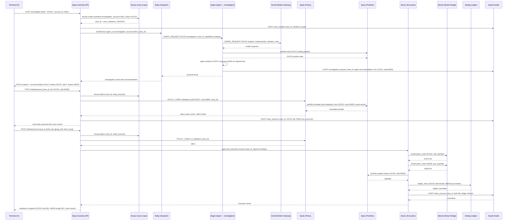

# UC-08: Portfolio Rebalancing — GOOG trim / AMZN add

## Description

The user holds GOOG and decides to investigate. After analysis, the user decides to trim GOOG and add AMZN — same sector (tech), but more diversified or introducing a growth angle not previously present. This is a **case-scoped rebalancing**: a single case groups the investigation, the policy decisions, the agent findings, the human approval, and the multi-trade execution.

The flow creates a case (`case_rebalance_{timestamp}`) that scopes all events under one deterministic sequence. This is different from UC-03/UC-04 (single trade) and UC-07 (exposure monitoring) — it's a multi-trade operation driven by agent investigation with human approval.

## Flow

## Tile Inventory

| Tile | Runtime ID | Responsibility | Status |
|------|-----------|----------------|--------|
| `tkapi` | `tkapi0` | Receives investigate + rebalance requests, coordinates case lifecycle | **MISSING** |
| `tkcase` | `tkcase0` | Creates deterministic case scope, attaches events to case, provides replay capsule | **PARTIALLY** — `tk_pass_stem.c` placeholder exists |
| `tkdisp` | `tkdisp` | Schedules investigation agent run | **EXISTING** — in investment workflow topology |
| `tkagnt` | `tkagnt` | Bounded investigation agent — analyzes GOOG, proposes AMZN | **PARTIALLY** — `runInvestmentAgent` exists for trading; needs `runInvestmentInvestigationAgent` |
| `tkmodl` | `tkmodl` | Model gateway for GOOG analysis | **EXISTING** — fixture/replay |
| `tkpoly` | `tkpoly` | Policy check for rebalance capability envelope (sell GOOG + buy AMZN) | **PARTIALLY** — exists, needs rebalance capability rules |
| `tkport` | `tkport0` | Portfolio read + simulate post-rebalance | **MISSING** — see UC-03 |
| `tkbrokr` | `tkbrokr0` | Broker bridge — executes GOOG sell and AMZN buy | **MISSING** — see UC-04, broker-bridge.md |
| `tkexec` | `tkexec0` | Approved execution for the swap | **MISSING** — see UC-04 |
| `tkledg` | `tkledg0` | Ledger — stores both transfers | **MISSING** — see UC-04 |
| `tkaudt` | `tkaudt` | Audit — records case_created, investigation_propose, trade_propose, trade_execute | **PARTIALLY** — needs `case_created`, `investigation_propose` record types |
| `tkmetr` | `metric` | Metrics | **EXISTING** |
| `tkdiag` | `tkdiag` | Diagnostics | **EXISTING** |

### What exists today (supporting)

- **`tk_pass_stem.c`** — placeholder for `tkcase` (exists in tile registry as stub).
- **`runInvestmentAgent`** — bounded agent that calls portfolio, quotes, policy; produces trade ticket.
- **`portfolio.BrokerageAccount`** — 5 fixture accounts with holdings.
- **`trade_ticket.TradeTicket`** — ticket with policy outcome, blocked reasons.
- **`mock_adapter`** — canned portfolio_snapshot, quote_snapshot.
- **`mock_broker_market_server`** — HTTP stub for portfolio and quotes.

### What's needed

1. Implement `tkcase` tile process: `case.create` creates a deterministic case scope with workflow, actor, account, and initial scope. `case.attach` attaches events to the case. `case.capsule` returns all events for replay.
2. Add `case_created`, `investigation_propose`, `rebalance_execute` record types to `tkaudt`.
3. Implement `runInvestmentInvestigationAgent` — bounded agent that analyzes a single ticker (fundamentals, valuation, risk profile) and proposes a rebalancing action (trim/add).
4. Add `rebalance` capability to `tkpoly` — checks sell-side (existing holding, no short-sale issues) and buy-side (notional limits, sector limits, instrument allowlist).
5. Register `tkcase` in tile registry with proper link shape (consumer of `tkapi`, producer to `tkaudt`).
6. Wire `tkcase` into a new rebalance topology.
7. Implement `tkapi` handlers: `POST /investigate` and `POST /trade/propose` (case-scoped).
8. Implement `tkexec` case-scoped execution: verifies case_id, calls `tkbrokr` for both trades, updates `tkport`, posts to `tkledg`, audits via `tkaudt`.

### System test approach

- Launch the rebalance topology with `tkapi`, `tkcase`, `tkdisp`, `tkagnt`, `tkmodl`, `tkpoly`, `tkport`, `tkbrokr`, `tkexec`, `tkledg`, `tkaudt`, `metric`, `tkdiag`.
- Use `mock_adapter` with `technology_heavy` fixture (owns GOOG 500 shares, 15% of portfolio).
- Use `mock_model` for GOOG analysis with canned response recommending AMZN.
- Use `tkbrokr` default backend (always returns filled).
- Send `/investigate?ticker=GOOG&account_id=2001` through `tkapi`.
- Verify: `tkcase` created the case with correct scope; `tkagnt` ran the investigation and produced a proposal; `tkpoly` allowed the rebalance (same sector, within limits); `tkaudt` recorded `case_created` and `investigation_propose`; terminal received the recommendation.
- Send `/trade/execute?case_id=...` through `tkapi`.
- Verify: `tkexec` executed both trades; `tkport` updated (less GOOG, more AMZN); `tkledg` posted both transfers; `tkaudt` recorded `rebalance_execute`; case is complete.
- Replay test: captured capsule with substituted model, broker, and ledger data produces identical rebalance result.
- Test policy deny: rebalance that exceeds sector limit (e.g., add 3 more tech positions when already at 20%) — `tkpoly` should deny.
